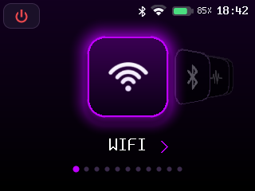
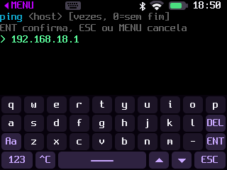

# CyberDeck

Firmware próprio para um cyberdeck de bolso feito com a placa **LCDwiki 2.8" ES3C28P** (ESP32-S3) e um teclado Bluetooth.

O deck abre num menu em carrossel com toque (visual inspirado no [TentacleOS](https://github.com/HighCodeh/TentacleOS)), tem um terminal com shell própria e ~30 ferramentas de rede, rádio, arquivos e utilitários.

 

## Hardware

| Item | Detalhe |
|---|---|
| Placa | LCDwiki ES3C28P — ESP32-S3 (2 núcleos 240 MHz), 16 MB flash, 8 MB PSRAM |
| Tela | 2.8" IPS 320×240, ILI9341 (SPI) |
| Toque | FT6336 capacitivo (I2C) |
| Armazenamento | microSD (SDMMC 4 bits), montado em `/sd` |
| Teclado | qualquer teclado **BLE** (o S3 não tem Bluetooth Classic) |

Pinagem completa em [docs/HARDWARE.md](docs/HARDWARE.md).

## Compilar e gravar

Precisa do **ESP-IDF v6.1** e Python 3.10+.

```sh
. ~/esp/esp-idf-v6.1/export.sh
idf.py build
idf.py -p /dev/cu.usbmodemXXXX flash
```

Primeira vez num cartão/placa nova: `idf.py -p PORTA erase-flash flash`.

## Usando

Tudo funciona **só com a caneta/dedo** ou **só com o teclado**.

| Ação | Toque (caneta) | Teclado |
|---|---|---|
| Trocar item no menu | deslizar para o lado, ou tocar num tile lateral | ← → |
| Abrir | tocar no tile do centro | Enter |
| Voltar ao menu | **◀ MENU** no canto superior esquerdo (em todas as telas) | Esc |
| Digitar | botão de **teclado** no cabeçalho (abre o teclado na tela) | teclado BLE |
| Rolar o terminal | deslizar para cima/baixo | PgUp/PgDn, Shift+↑/↓ |
| Continuar ("-- mais --") / fechar resultado | tocar | Enter / qualquer tecla |
| Parar um comando longo | tocar, ou ◀ MENU | Ctrl+C ou q |

Quando uma ferramenta pede argumentos (ex.: o IP do `ping`), o teclado na tela abre sozinho. Ele tem três camadas (letras, `123`, `#+=`), maiúscula (`Aa`), `^C`, setas e `ESC`.

**Terminal:** item *Terminal* do menu. Comandos principais (`help` lista todos):

| Categoria | Comandos |
|---|---|
| sistema | `menu` `sysinfo` `date` `uptime` `mem` `wifi` `bt` `font` `volume` `bateria` `desligar` `autooff` `touchtest` `reboot` |
| rede | `ping` `netscan` `portscan` `dns` `http` `myip` `weather` |
| rádio | `blescan`, `wifi scan`, `deauth` (detector) |
| arquivos | `ls` `cd` `pwd` `cat` `hexdump` `write` `touch` `mkdir` `rm` `mv` `df` |
| utils | `calc` `passgen` `sha256` `base64` `matrix` |

Teclado físico no terminal: **↑/↓** histórico, **Ctrl+C** interrompe, **Ctrl+L** limpa.

**Conectar no Wi-Fi (sem teclado físico):** no menu, **WiFi -> conectar**: ele procura as redes, mostra a lista com sinal e cadeado, você toca na sua, digita a senha no teclado da tela e pronto. Fica salvo e reconecta sozinho. (No terminal ainda dá: `wifi connect "MinhaRede" senha`.)

**Ajustes:** no menu, *Ajustes* (⚙) abre a tela de configurações: **brilho**, **volume**, **tempo para desligar sozinho** (nunca a 60 min) e **tamanho da fonte**. Setas mudam, ou toque no `-`/`+` de cada linha. Tudo fica salvo.

**Ligar e desligar (na bateria):** o botão **⏻** no canto superior esquerdo da home (ou Esc na home) abre a confirmação; *Sistema → desligar* também. Desligar apaga a tela, desliga som e rádio e põe o ESP32-S3 em deep sleep. **Tocar na tela** ou apertar **BOOT** liga de novo (RESET também). Sem uso por 5 min ele desliga sozinho; mude com `autooff <minutos>` (`0` = nunca). Para guardar por muito tempo, uma chave no fio da bateria corta o consumo de vez (ver [HARDWARE](docs/HARDWARE.md)).

**Status no topo:** Bluetooth, Wi-Fi (força do sinal), bateria com a **porcentagem** e hora (sincronizada pela internet; aparece uns 15–20 s depois de ligar com Wi-Fi).

**Carregando:** com o cabo USB-C ligado, aparece um raio no ícone da bateria (amarelo carregando, branco cheia) e toca um som ao plugar/desplugar. `bateria` mostra a carga, a tensão e o estado.

**Sons** (alto-falante da placa, mesmos tons do TentacleOS): acorde ao ligar, clique ao navegar e ao teclar no teclado na tela, tom de seleção, sinal de "achou algo" ao fim dos scans, de "gravado" ao salvar arquivo, e de erro. `volume 0` silencia; o volume fica salvo.

## Detector de deauth

No menu (categoria WiFi) ou pelo comando `deauth`: a placa entra em modo monitor (escuta passiva, **não transmite nada**) e mostra ao vivo os quadros de *deauthentication/disassociation* no ar — total, taxa por segundo num gráfico, canal e a origem — com alerta quando há um ataque em andamento. Serve para **aprender e detectar** o ataque pelo lado da defesa. Ao sair, reconecta no Wi-Fi salvo.

## Bad USB

A placa pode virar um teclado USB e digitar um script (DuckyScript) no computador — para automação e **testes autorizados** (use só em máquinas suas ou com permissão). No menu: **Bad USB**. Os scripts ficam em `/sd/badusb/*.txt`; o deck lista, mostra o script e só digita depois que você confirmar **INJETAR**. Enquanto o teclado USB está ativo, o console serial fica indisponível até reiniciar.

## Documentação

- [docs/ARCHITECTURE.md](docs/ARCHITECTURE.md) — módulos, renderização, carrossel, entrada
- [docs/HARDWARE.md](docs/HARDWARE.md) — pinagem, módulos que faltam (SubGHz, NFC...)
- [docs/CHANGELOG.md](docs/CHANGELOG.md) — histórico do que foi feito

## Créditos

- Fontes [Spleen](https://github.com/fcambus/spleen) (BSD-2) — `fonts/`
- Ícones e paleta do [TentacleOS](https://github.com/HighCodeh/TentacleOS) (GPL-3.0) — convertidos por `tools/png2icons.py`
- Código BLE HID baseado no exemplo `esp_hid_host` do ESP-IDF (Unlicense/CC0)
